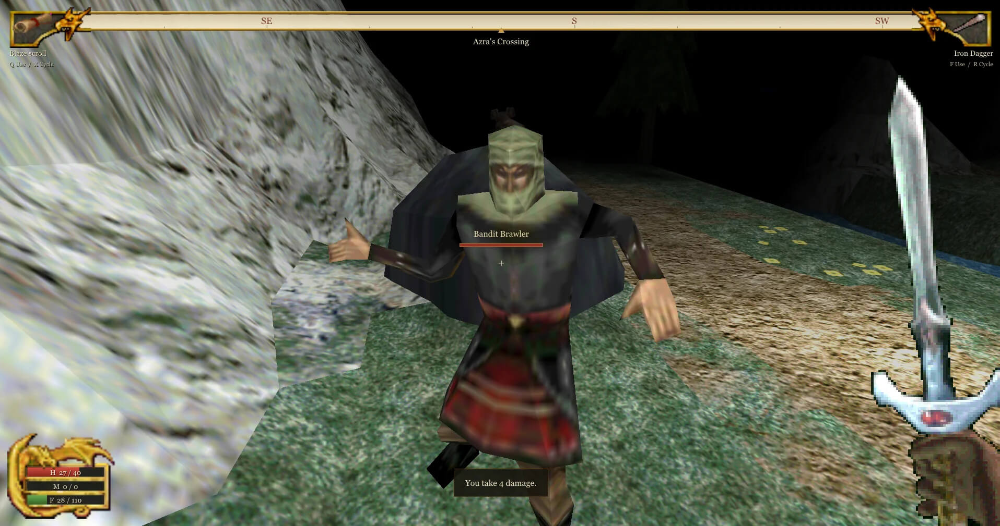

<b>Pathway to Glory</b> — це тактична стратегія від RedLynx, яку Nokia випустила ексклюзивно для N-Gage у листопаді 2004 року. Дія відбувається у Другій світовій війні: ви командуєте загоном із 6 солдатів, виконуючи місії від висадки на Сицилії до прориву до Німеччини . Гра отримала 83/100 на Metacritic і вважається однією з найкращих ігор на N-Gage .

Тепер з'явився PTGDroid — неофіційний відкритий порт для Android. Ключове: це не емулятор телефона. Оригінальний ARM-код гри або перекомпільовується в C, або виконується маленьким інтерпретатором, а частини Symbian OS, які використовує гра, реалізовані нативно поверх SDL2.

{:.img-center}

Як працює

N-Gage працював на Symbian OS 6.1 з ARM920T. PTGDroid не вдає з себе телефон цілком — він завантажує виконувані файли гри з вашої копії, застосовує релокації та підставляє власні реалізації системних API: купу, файли, таймери, віконний сервер. Гра «думає», що працює на Symbian, а насправді — на Android. Опублікований APK використовує інтерпретатор (не містить коду гри взагалі), а рекомпільовані збірки працюють швидше, але їх потрібно збирати самостійно зі своєї копії.

[Репозиторій](https://github.com/ItsJustBshawn/OpenShadowKey)

Як запустити готовий APK

- Завантажте PTGDroid-<version>.apk зі сторінки Releases і встановіть його (потрібен 64-бітний Android 7.0 або новіший).
- Зробіть ZIP з резервної копії вашої ігрової картки. Він має містити game.id та папку system з system/apps/6r72/6r72.app, data.pak і zlib.dll (можна й у вкладеній папці).
- Відкрийте PTGDroid і виберіть ZIP. Файли копіюються у приватне сховище застосунку — це потрібно зробити лише раз. Збереження та налаштування також зберігаються там.
